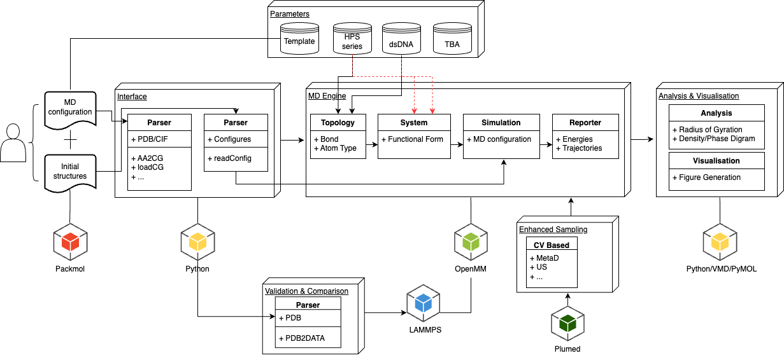

# cg-dsDAN-openmm

This program is initially prepared to implement the double strand DNA model under the framework of HPS

Author info: Qiang Zhu (Vice-Chancellor Research Fellow at University of Wollongong)

## Architecture




## How to install


## How to use


## Cookbook

### Step 1: Structure (Monomer) cleanup
The structure should be pre-processed before converting into coarse-grained resolution, we suggest to use `pdb4amber`, a command provided by AmberTools.

The main purpose here is to retain the chain ID and make the residue ID consecutive, both two identifier are necessary for the following structural construction. Especially for coarse graining double strand DNA (dsDNA).

If we did not specify `--noter`, the dsDNA (whole species) will be splited into two parts with `TER` added between consecutive chains (that is not what we expected)
```
pdb4amber -i model.pdb -o reorder.pdb --noter
```


### Step 2: Complex construction
At this stage, you may resort to external programs, such as `packmol` or `gromacs`. Here, we detailed the procedure using these two programs.

***Using `packmol`***

```
add_amber_ter # this command is necessary for the following coarse-graining

tolerance 2.0
filetype pdb
output mixture.pdb

structure species_1.pdb  # specify the location of composition 1
  number 100             # the number you want to put in the box
  inside box 0. 0. 0. 1000. 1000. 1000.  # box info
end structure

structure species_2.pdb  # specify the location of composition 2
  number 25
  inside box 0. 0. 0. 1000. 1000. 1000. 
end structure
```

If `packmol` successfully generates the complex, the resulting structure can be directly used in the next stage without further modification. 

(***This approach is efficient for small systems, but not for much larger ones.***)


***Using `gmx insert-molecules`***

``` 
gmx insert-molecules -ci species_1 -o complex1.pdb -nmol 100 -box 100 100 100 # insert species 1 into specified box
gmx insert-molecules -ci species_2 -f complex1.pdb -o complex1_1.pdb -nmol 25 -box 100 100 100 # insert species 2 into specified box

# you can insert other species following the previous command
```

Once done with `gromacs`, we need to insert `TER` at the end of each molecule.

For your convenience, we provide a script to add `TER` automatically.
```
cleanPDB.py -i md.conf # we will introduce how to prepare md.conf for such simulation
```

### configure preparation

